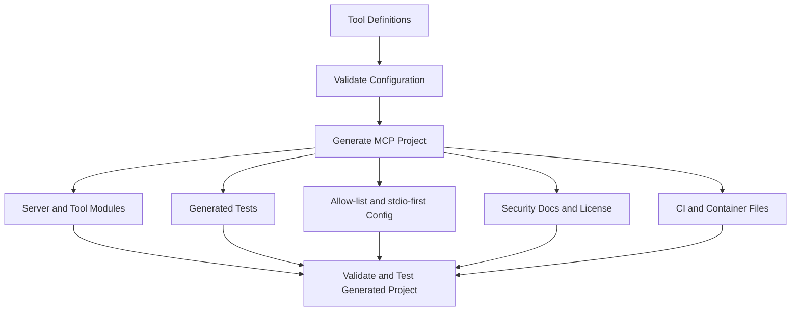
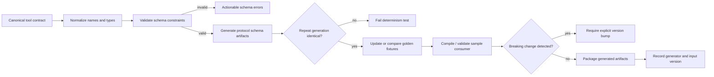

# x4-mcpgen

[](https://github.com/dhe-cruzer69/x4-mcpgen/actions)
[](LICENSE)

**Generate production-oriented MCP server scaffolds — secure by default.**

Part of the X4 ecosystem: `x4-skills → x4-mcpgen → x4-sec → x4-runtime → x4-obs`

## 30-second demo

```bash
pip install -e ".[dev]"
x4-mcpgen init weather --tools 2
cd weather
pip install -e ".[dev]"
pytest -q
x4-mcpgen validate .
x4-mcpgen test .
```

## Why not another template?

Most MCP starters ship with broad permissions and no tests. **x4-mcpgen** produces:

- Explicit tool allow-lists (no `"*"`)
- Unit tests for every generated tool
- `SECURITY.md`, Apache-2.0, CI workflow
- `mcp.json` with stdio transport only by default
- Dockerfile with non-root user
- Ready for `x4-sec scan`

## CLI

```bash
x4-mcpgen init <name> [--tools N] [--out DIR]
x4-mcpgen validate [PATH]
x4-mcpgen test [PATH]
x4-mcpgen package [PATH]
x4-mcpgen doctor
```

## Generated layout

```text
my-mcp/
├── src/<pkg>/
│   ├── server.py
│   └── tools/
├── tests/
├── schemas/
├── Dockerfile
├── mcp.json
├── pyproject.toml
├── README.md
├── SECURITY.md
├── LICENSE
└── .github/workflows/ci.yml
```


## Architecture — Mermaid scope map



## License

Apache-2.0

## APEX Architecture Map

> Status: architecture documentation; implementation and deployment claims require independent verification.


**Evidence note:** Deterministic output, compatibility checks, and consumer validation are proposed quality gates; verify they exist before claiming code generation is production-safe.

